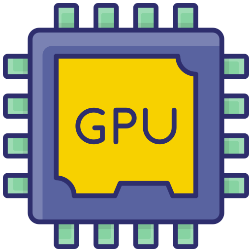

<p align="center">
  
</p>

# GPU Memory Master

A modern desktop application built with Python and CustomTkinter designed for analyzing GPU hardware specifications and calculating memory bandwidth, compute throughput (TFLOPS), and AI performance (TOPS).

## Features

- **Cloud Preset Database:** Dynamically retrieves up-to-date specifications for modern GPUs directly from GitHub on launch.
- **Live Autocomplete Search:** Type any model number (such as `5090`, `4080`, or `7900`) to instantly filter and auto-fill hardware parameters.
- **Memory Analysis:** Automatically calculates bandwidth (GB/s), effective speed (Gbps), and memory bus width (Bit).
- **Compute Power:** Computes FP32 TFLOPS based on architecture multipliers, shading units, and boost clock frequencies.
- **AI Performance:** Calculates INT8/FP8 AI TOPS for supported modern architectures (Blackwell, Ada/Ampere, RDNA 3+, Intel Battlemage/Alchemist).
- **Interactive & Editable:** All pre-filled fields remain fully editable for custom overclocking and simulation scenarios.

## Supported Architectures

- **NVIDIA:** Blackwell, Ada Lovelace, Ampere, Turing, Pascal, Maxwell
- **AMD:** RDNA 3 / 4 / 5+, RDNA 1 / 2, GCN 1-5
- **Intel:** Arc Battlemage (B-Series), Arc Alchemist (A-Series)

## Requirements

- Python 3.10 or higher
- `customtkinter` 5.2.0 or higher

## Installation

1. Clone this repository:
   ```bash
   git clone https://github.com/pantegra17/GPU-Memory-Master.git
   cd GPU-Memory-Master
   ```

2. Install dependencies:
   ```bash
   pip install -r requirements.txt
   ```

3. Run the application:
   ```bash
   python main.py
   ```

## Author

- **Developer:** Gökhan Can
- **Contact:** pantegra@gmail.com
- **GitHub:** [@pantegra17](https://github.com/pantegra17)

## License

This project is open source and available under the MIT License.
